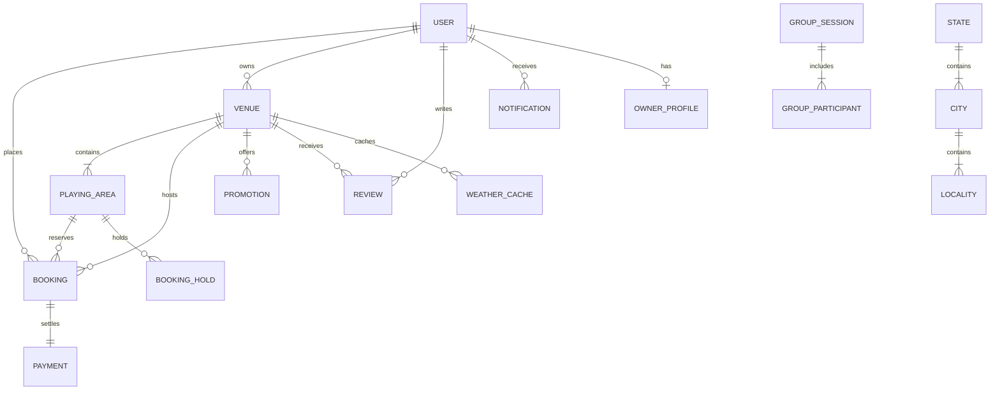

# BookMyPlayground 2.0 — India's Smart Sports Ground Booking Platform

> **Third-Year Computer Engineering Project**  
> **Course:** Web Development Lab (WDL) with Advanced Data Structures & Algorithms  
> **Live Architecture:** MERN Stack (MongoDB, Express.js, React.js, Node.js) + Vite + Tailwind CSS + Leaflet + Open-Meteo  

---

## 📌 Executive Summary

**BookMyPlayground** is an Indian sports ground discovery, recommendation, and booking platform inspired by the design and UX of BookMyShow. It enables players across India to discover verified grounds for **exactly six sports**, review live slot availability, lock slots with a 10-minute concurrency hold, and complete simulated instant checkouts with zero double-booking risk.

---

## ⚡ The Four Smart Innovations

### 1. Smart Ground Recommendation Engine
- **Page:** `/smart-finder` • **API:** `POST /api/recommendations/smart`
- Multi-factor scoring formula evaluated over MongoDB candidate records:
  $$\text{Score} = w_{\text{dist}} \cdot S_{\text{dist}} + w_{\text{price}} \cdot S_{\text{price}} + w_{\text{avail}} \cdot S_{\text{avail}} + w_{\text{fac}} \cdot S_{\text{fac}} + w_{\text{rate}} \cdot S_{\text{rate}}$$
- Default weights: Distance 25%, Price 25%, Availability 25%, Facilities 15%, Rating 10%.
- Efficient **Min Heap / Priority Queue** extracts the Top-K venues in $O(N \log K)$ time.
- Transparent explainability breakdown explaining why a ground received a given score (e.g., *"92% Match — located 3.2 km away, fits your ₹2000 budget, has floodlights, and confirmed slot available"*).

### 2. Group-Friendly Ground Finder
- **Page:** `/group-finder` • **API:** `POST /api/groups/:id/recommendations`
- Solves the common problem where friends live in different areas of a city (e.g. Kalyan, Dombivli, Thane):
  $$\text{Group Cost} = 0.60 \times \text{Normalised Total Travel Distance} + 0.40 \times \text{Normalised Max Individual Distance}$$
- Features an educational **Graph & Dijkstra Shortest Path Solver** over an MMR (Mumbai Metropolitan Region) transit network.

### 3. Weather-Aware Booking Radar
- **API:** `GET /api/weather/venue/:id?date=YYYY-MM-DD`
- Real-time integration with **Open-Meteo Weather API** using GPS coordinates.
- Classifies weather risk (**LOW**, **MODERATE**, **HIGH**) based on precipitation probability, rainfall amount (mm), and wind speed.
- If high rainfall is forecast on an outdoor turf, the engine uses a Priority Queue to automatically rank and suggest **covered/indoor all-weather alternatives**.

### 4. Smart Slot Optimisation for Ground Owners
- **Page:** `/dashboard/owner` • **API:** `GET /api/owner/slot-optimisation`
- Real-time occupancy analytics calculated directly from MongoDB bookings:
  $$\text{Occupancy Rate} = \frac{\text{Booked Available Hours}}{\text{Total Bookable Hours}} \times 100$$
- Evaluates booking distributions using **Custom Hash Maps** to identify unbooked afternoon lulls (e.g. Weekdays 2 PM–5 PM).
- Generates dynamic promotional discount rules with 1-click activation.

---

## 🏆 Exactly Six Supported Sports

BookMyPlayground strictly supports:
1. 🏏 **Cricket** (Box Cricket & Full Net Pitches)
2. ⚽ **Football** (FIFA-grade 5v5 & 7v7 Turfs)
3. 🏓 **Pickleball** (International Standard Courts)
4. 🏑 **Hockey** (Synthetic Astroturf Grounds)
5. ⛳ **Golf** (Driving Ranges & Putting Greens)
6. 🤼 **Kabaddi** (Synthetic Mats & Mud Arenas)

---

## 🧠 Data Structures & Algorithms Integration (Viva Showcase)

Visit **`/data-structures`** on the running web platform for live interactive visualizers and execution traces of all 8 algorithms:

| # | Algorithm / Data Structure | Practical Purpose in BookMyPlayground | Time Complexity | Space Complexity |
|---|---|---|---|---|
| **1** | **Trie (Prefix Tree)** | Global search bar autocomplete for venues, cities, and localities | $O(m)$ search | $O(\Sigma \cdot N \cdot M)$ |
| **2** | **Min Heap / Priority Queue** | Top-K smart ground recommendation ranking & weather alternatives | $O(\log N)$ insert/extract | $O(N)$ |
| **3** | **Graph & Dijkstra** | Shortest path and travel cost computation in Group Finder | $O((V+E)\log V)$ | $O(V+E)$ |
| **4** | **Custom Hash Map** | Bucket chaining for $O(1)$ slot conflict checks and analytics aggregation | $O(1)$ average | $O(B + N)$ |
| **5** | **Merge Sort** | Stable divide-and-conquer venue sorting by price, rating, or score | $O(N \log N)$ | $O(N)$ |
| **6** | **Interval Overlap** | Concurrency conflict detection: $s_A < e_B \land s_B < e_A$ | $O(1)$ overlap check | $O(1)$ |
| **7** | **Haversine Formula** | Great-circle distance in kilometers on Earth's sphere ($R=6371$ km) | $O(1)$ | $O(1)$ |
| **8** | **Weighted Multi-Factor Formula** | Normalized transparent scoring for multi-attribute matching | $O(1)$ per venue | $O(1)$ |

---

## 👥 Demo User Accounts (Pre-Seeded)

| Role | Email Address | Password | Pre-Configured Facilities |
|---|---|---|---|
| **Super Admin** | `admin@bookmyplayground.in` | `Admin@123456` | Full platform moderation, owner reviews, venue approvals |
| **Ground Owner (Mumbai)** | `rohit.sharma@mumbaiturfs.in` | `Owner@123456` | Neville D'Souza Turf, Wings Sports Centre, Astro Park |
| **Ground Owner (Thane)** | `vikram.patil@thanesports.in` | `Owner@123456` | Urban Sports Park, Golden Swan Golf Academy |
| **Ground Owner (Bengaluru)**| `karthik.rao@bengaluruarenas.in` | `Owner@123456` | Play Arena Sarjapur, Bangalore Golf Club |
| **Customer 1** | `rahul.verma@gmail.com` | `Customer@123456` | Active bookings in Mumbai |
| **Customer 2** | `sneha.deshmukh@gmail.com` | `Customer@123456` | Active bookings in Thane |

---

## 🗄️ Database Architecture (20 Mongoose Schemas)



---

## 🚀 Running the Project

### Prerequisites
- Node.js v18+ (tested on Node v22.20.0)
- npm v10+

### Step 1: Start Backend Server
```bash
cd server
npm install
npm run seed     # Seeds genuine Indian venues, locations, and demo users
node server.js   # Starts on port 5000 (MongoDB auto-starts with persistent storage)
```

### Step 2: Start Frontend Client
```bash
cd client
npm install
npm run dev      # Starts on http://localhost:5173
```

---

## 🧪 Automated Test Verification

Run all test suites to verify algorithms and APIs:

```bash
cd server
npm test                 # Executes 8 algorithm unit tests
node tests/testEndToEnd.js # Executes 18 end-to-end integration tests over HTTP
```

**Status:** `26 / 26 Tests Passed (100% Success Rate)`
